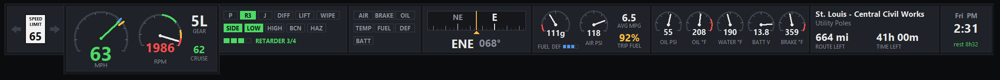
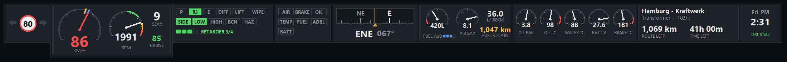

# TruckBar

A slim instrument bar for **American Truck Simulator** and **Euro Truck Simulator 2**
that sits along the top of your screen. You can read speed, revs, gear, lights,
warnings, fuel and your job at a glance, and nothing covers your mirrors.





- Reads the game's live telemetry. It doesn't change the game, install a mod or capture the screen.
- **Never takes keyboard focus.** Per-game profiles in Razer Synapse, Logitech G HUB and
  similar tools stay on the game.
- Adjustable opacity and size, and every section can be shown or hidden.
- Works with single screens, ultrawides and triple-screen setups.

---

## What's on the bar

From left to right. Every section can be switched off.

| Section | Shows |
|---|---|
| **Signals** | Left/right turn signals and the posted speed limit (US sign in ATS, EU roundel in ETS2) |
| **Speed** | Big speedometer, tachometer, gear, cruise set speed. This panel hangs slightly below the bar. |
| **Status lights** | Park brake, retarder (with its current step), engine/Jake brake, diff lock, lift axle, wipers, side/low/high beams, beacon, hazards, plus a row of pips counting retarder steps |
| **Warnings** | Low air, emergency brake, oil pressure, coolant temperature, low fuel, low DEF/AdBlue, battery |
| **Compass** | A scrolling compass tape with the direction you're facing under the centre mark, plus the 16-point heading and degrees (e.g. `ENE 068°`) |
| **Fuel** | Fuel gauge with reserve zone, DEF/AdBlue level, air pressure, average economy, and **trip fuel**: how much of the fuel on board the rest of the job needs |
| **Gauges** | Oil pressure, oil temperature, coolant temperature, battery voltage, brake temperature |
| **Job** | Destination, cargo, distance and time left |
| **Clock** | In-game day and time (12- or 24-hour) and time until you need to rest |

### Reading the speedometer

- The needle and number are **green** at or under the limit, **amber** up to 5 over, and **red** beyond that.
- An **amber notch** on the rim marks the posted speed limit.
- A **blue notch** marks your cruise control set speed. It turns grey when a speed is set but cruise is off.

### Reading the tachometer

The bands are scaled to your engine's governed RPM. For a typical 2,100 RPM truck engine:

| Band | RPM | Meaning |
|---|---|---|
| Green | about 1,090–1,490 | Economy: where you want to cruise |
| Amber | about 1,700–1,900 | Working hard. The RPM number turns amber. |
| Red | about 1,900 and up | Near the governor. The RPM number **blinks red**. |

### Trip fuel colours

| Colour | Meaning |
|---|---|
| Green | The job needs under 75% of the fuel on board |
| Amber | It needs 75–100%. Plan a stop. |
| Red | You won't make it without refuelling |

### Gear names

TruckBar names gears the same way your in-game dash does, using the **H-shifter layout**
you've chosen in the game's controls options. With an Eaton Fuller 18 layout, for example,
you'll see `LL`, `LH`, `1L` … `8H`.

The game uses one layout for every truck. So if you drive a 13-speed truck with an 18-speed
layout selected, both the dash and TruckBar show 18-speed names, and the top gear will be
6L. Change the layout in the game to match the gearbox and the names follow within about 10 seconds.

The game's built-in layouts (such as "splitter") have no names, so those show gear numbers.
You can also tick **"Gear names like the dash"** off in Settings to always show numbers.

### Units

TruckBar picks the units from the game:

| | ATS | ETS2 |
|---|---|---|
| Speed | mph | km/h |
| Distance | miles | km |
| Fuel | US gallons, mpg | litres, L/100 km |
| Pressure | psi | bar |
| Temperature | °F | °C |

---

## Requirements

- **Windows 10 or 11**
- **Python 3.10 or newer** from [python.org](https://www.python.org/downloads/windows/).
  Keep **tcl/tk and IDLE** ticked in the installer; it's on by default. TruckBar uses only the
  standard library, so there is nothing else to install.
- **The scs-telemetry plugin, revision 12**, from
  [RenCloud/scs-sdk-plugin](https://github.com/RenCloud/scs-sdk-plugin/releases) (release
  `V.1.12.1`). This is the same plugin many dashboards and companion apps use, so you may
  already have it.

### Installing the telemetry plugin

1. Download the release and find `scs-telemetry.dll` (the 64-bit one).
2. Copy it into the game's plugin folder, and create the `plugins` folder if it isn't there:
   - ATS: `...\steamapps\common\American Truck Simulator\bin\win_x64\plugins\`
   - ETS2: `...\steamapps\common\Euro Truck Simulator 2\bin\win_x64\plugins\`
3. Start the game. It shows a one-time **"advanced SDK features"** notice. Click **OK**.
   That's the game confirming the plugin loaded.

---

## Installing TruckBar

1. Download this repository: **Code → Download ZIP**, then unzip it anywhere, e.g. `C:\Tools\TruckBar`.
   Or `git clone` it.
2. Check it works without the game:
   ```
   python truckbar.pyw --demo
   ```
   A bar with made-up readings appears along the top of your main screen. Use `--demo-ets2`
   for the metric/ETS2 version. Close it with **Ctrl + Alt + B → Quit TruckBar**.

## Running it

Double-click `truckbar.pyw`, or run:

```
pythonw truckbar.pyw
```

Until a game is running, the bar shows *"waiting for ATS / ETS2 to start…"*. Once you're
in the game it fills in by itself. You can start TruckBar before or after the game.

### Starting and stopping it with the game

```
pythonw truckbar.pyw --exit-with-game
```

With `--exit-with-game`, TruckBar closes itself once the game has been running and then quits.
This suits launchers and scripts that start your companion apps together with the game.
If it's started before the game, it waits.

---

## Controls

Once you're driving, the game holds the mouse, so TruckBar is controlled by a hotkey.

| Input | What it does |
|---|---|
| **Ctrl + Alt + B** | Open or close the **settings window**. Works even while the game has focus. |
| Drag the bar | Move it (only when the mouse is free, e.g. in the game's menus) |
| Mouse wheel on the bar | Bigger or smaller |
| Ctrl + mouse wheel | More or less see-through |
| Right-click the bar | Open the settings window |

> **Tip:** ATS and ETS2 treat focus moving away from the game like letting go of the
> controls, and an H-shifter drops to neutral. Open the settings window when you're stopped.
> Clicking **"Done – back to the game"** hands focus straight back.

### The settings window

- **Show on the bar:** tick or untick each section. The bar shrinks to fit.
- **Opacity:** 20% to 100%.
- **Size:** 50% to 200%.
- **Gear names like the dash:** see [Gear names](#gear-names).
- **24-hour clock:** off gives 12-hour with AM/PM.
- **Position:** arrow buttons nudge the bar. **Centre along top** puts it back.
- **Lock position:** stops accidental dragging.
- **Quit TruckBar.**

Everything is saved as you change it, in `%APPDATA%\TruckBar\settings.json`.
Delete that file to go back to the defaults.

---

## Troubleshooting

**The bar stays on "waiting for ATS / ETS2 to start…" while I'm driving.**
The telemetry plugin isn't loaded. Check that `scs-telemetry.dll` is in `bin\win_x64\plugins`
(not `win_x86`) and that you saw the "advanced SDK features" notice when the game started.

**It says it needs plugin revision 12.**
You have a different version of the scs-telemetry plugin. Its data layout doesn't match
what TruckBar reads, so TruckBar refuses rather than showing wrong numbers. Install
release `V.1.12.1` of RenCloud's plugin.

**Ctrl + Alt + B does nothing.**
Another program has claimed that hotkey. Close it, or open settings by right-clicking the bar
from the game's menu, where the mouse is free.

**The bar is hidden behind the game.**
Run the game in **borderless** or **windowed** mode. Exclusive fullscreen draws over every
other window, TruckBar included.

**The gear names don't match my dash.**
TruckBar reads the H-shifter layout from your most recently used profile. If you switch
profiles, give it a few seconds. Built-in layouts show numbers (see [Gear names](#gear-names)).

**It slows the game down.**
TruckBar redraws 12 times a second and uses very little CPU. If you're tight on CPU anyway,
hide the sections you don't use.

---

## How it works

The scs-telemetry plugin publishes the game's live data in a block of shared memory
(`Local\SCSTelemetry`). `telemetry.py` maps that block into Python using the plugin's own
struct layout. The field offsets are checked against the plugin's header when TruckBar starts.
`truckbar.pyw` draws the bar with Tkinter as an always-on-top, non-activating window,
with see-through areas around the dropped speed panel.

## Credits

- Telemetry plugin: [RenCloud/scs-sdk-plugin](https://github.com/RenCloud/scs-sdk-plugin).
- Built around the official SCS Software telemetry SDK.

TruckBar is a fan-made tool and isn't affiliated with SCS Software.

## License

MIT. See [LICENSE](LICENSE).
